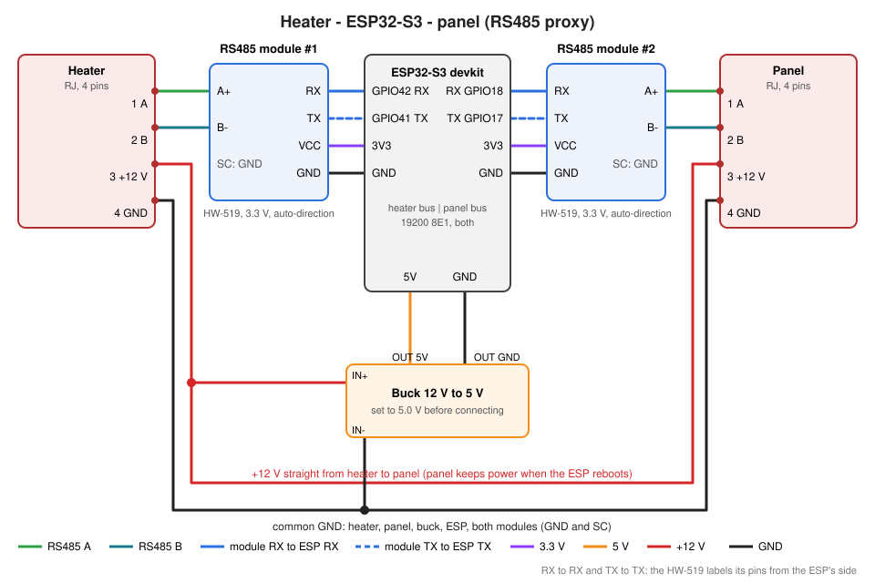

# esphome-tylo-proxy

[](https://ko-fi.com/pavelcu)
[](https://github.com/arctus/esphome-tylo-proxy/actions/workflows/build.yml)

An ESP32 between a **Tylo / Helo sauna heater** and its control panel, over
RS485. The panel keeps working exactly as before; the ESP adds a web page,
Home Assistant control, **usage rules** for a sauna that many people share,
and session statistics.

Built on [f-io/esphome-tylo](https://github.com/f-io/esphome-tylo), which
decodes the heater protocol. This project wires the ESP *between* heater
and panel instead of onto the same bus, and builds the rest on that.

> **Status.** Running on two Tylo Pure heaters with the basic panel, in
> shared use. The Wi-Fi fallback (`network-fallback.yaml`) is new in 1.0.0
> and compiles, but has had less time on real hardware than the rest. Other
> heaters and panels are untested - reports are very welcome.

## What it does

- **RS485 proxy.** Every frame is forwarded whole in both directions. If the
  panel is late, the ESP answers the heater for it; the ESP's own commands
  go out in the panel's keep-alive slot. Three bus modes: *Listen* (never
  transmits), *Forward*, *Forward + Control*.
- **Usage rules** for a shared sauna, enforced at the proxy:
  - *Sauna Allowed* - switch the panel's heater button off entirely;
  - *Temperature Limit* - written into the heater's own maximum, so it holds
    even without the ESP;
  - *Session Time Limit* - counted from "warm" (within 10 C of target), with
    the heater's own bath time held as a backstop if the ESP dies;
  - *Restart Cooldown* after a limit stop, a two-blink light warning 5
    minutes before one;
  - *Opening Hours* (a session that started while open runs to its end) and
    *Relax Today*.
- **Statistics:** number of sessions, total heating time, average and
  median, and the last 64 sessions with start time and how they ended.
  Kept across reboots.
- **Clock from the internet** when the network has it: the heater's clock is
  set and kept right (daylight saving included) without anyone pressing a
  button. Without internet, the phone sync on `/sauna` does it.
- **Settings survive a restart:** the heater only reports a setting when it
  changes, so the last-known temperature level, bath time and limits are
  kept in flash and shown after a restart until the heater reports again
  (display only - never written back).
- **Web UI on the device**, in sections (Heater, Session, Configuration,
  Statistics, Diagnostics), plus a `/sauna` page with the full history and a
  button that sets the heater's clock from your phone. Optionally behind a
  login (`packages/web-auth.yaml`).
- **Network your way:** join Wi-Fi when it is there and fall back to the
  device's own access point when it is not, without the fallback's constant
  rescanning knocking phones off the page - or run as an access point only,
  for a sauna with no Wi-Fi. Home Assistant is optional either way.

Full description: [docs/behaviour.md](docs/behaviour.md).

## Hardware

| Part | Notes |
|---|---|
| ESP32-S3 devkit | e.g. ESP32-S3-DevKitC-1; any ESP32 with two free UARTs |
| 2x HW-519 TTL-to-RS485 module | 3.3 V, auto-direction |
| Buck converter 12 V to 5 V | powers the ESP from the heater's 12 V |



Only the panel's data lines go through the ESP; its +12 V and GND come
straight from the heater, so the panel never loses power. Connection table,
checks and the fallback without the ESP: [docs/wiring.md](docs/wiring.md).

**Wire RX to RX and TX to TX** on the HW-519 - it labels its pins from the
microcontroller's side.

## Installation

### 1. Device configuration

```yaml
substitutions:
  device_name: tylo-sauna
  friendly_name: Sauna
  ap_ssid: "Sauna"
  ap_password: !secret sauna_ap_password   # 8+ characters, given to users
  wifi_ssid: !secret wifi_ssid
  wifi_password: !secret wifi_password
  api_encryption_key: !secret sauna_api_key  # also encrypts OTA
  web_password: !secret sauna_web_password   # with web-auth.yaml

esphome:
  name: ${device_name}
  friendly_name: ${friendly_name}

esp32:
  board: esp32-s3-devkitc-1
  flash_size: 8MB
  framework:
    type: esp-idf

external_components:
  - source: github://arctus/esphome-tylo-proxy@v1.1.0
    components: [sauna360, sauna_wifi]

packages:
  tylo:
    url: https://github.com/arctus/esphome-tylo-proxy
    ref: v1.1.0
    files:
      - packages/proxy.yaml
      - packages/network-fallback.yaml   # or packages/network-ap-only.yaml
      - packages/web-auth.yaml           # optional: login on the web UI

# The heater clock is local time: set your zone (default: the compiling machine's).
time:
  - id: !extend sntp_time
    timezone: Europe/Madrid
```

With `network-ap-only.yaml`, leave out `wifi_ssid` and `wifi_password`.
[`example/tylo-sauna.yaml`](example/tylo-sauna.yaml) is the same config
building from a checkout of this repo.

### 2. Flash

The first flash goes over USB (`esphome run tylo-sauna.yaml`); later ones
over the air. Then open the device's address, or join its access point and
open `http://192.168.4.1`, and check the Diagnostics section against
[docs/wiring.md](docs/wiring.md#checking-it-from-the-web-ui).

### 3. Set the clock

Opening hours and session start times need the heater's clock, which the
basic panel never sets. With internet on the network the device sets it by
itself (and keeps it right through daylight saving). Without internet, open
`/sauna` on your phone and press *Sync clock from this phone*, and repeat
when daylight saving changes.

## Configuration

Set any of these in your `substitutions:` to override the default:

| Substitution | Default | Meaning |
|---|---|---|
| `heater_tx_pin` / `heater_rx_pin` | `GPIO41` / `GPIO42` | heater bus (RS485 module #1) |
| `panel_tx_pin` / `panel_rx_pin` | `GPIO17` / `GPIO18` | panel bus (RS485 module #2) |
| `panel_reply_timeout` | `60ms` | how long the panel gets before the ESP answers for it (5-150 ms) |
| `model_name` | `elite` | upstream model masks; `elite` decodes the Pure's relays correctly, see [protocol.md](docs/protocol.md#findings-worth-knowing) |
| `min_temp_c` / `max_temp_c` | `40` / `110` | climate entity range |
| `heater_max_temperature_c` | `110` | heater maximum restored when the temperature limit is switched off |
| `policy_temp_limit` | `Level 9 (102 °C)` | initial limit, spelled exactly as a *Max Allowed Temperature* option |
| `policy_session_limit` | `60 min` | initial session time limit |
| `policy_cooldown` | `5 min` | initial restart cooldown |
| `policy_open_time` / `policy_close_time` | `07:00:00` / `22:00:00` | initial opening hours |
| `log_level` | `DEBUG` | compiled level; it runs at INFO, the *Log Level* select raises it |

The policy values are only the first-boot defaults: after that they are set
in the web UI (Configuration) or from Home Assistant, and kept across
reboots. The Wi-Fi fallback timings are on the `sauna_wifi:` block in
`network-fallback.yaml` (`search_time`, `retry_interval`, `max_defer`); to
change them, copy that package into your config.

## Safety

A sauna heater is a high-power, high-temperature appliance. This project
only talks to the heater's control bus; it never touches mains wiring, and it
leaves the heater's own safety functions (door contact, overheat cut-off)
alone. Still:

- Work on the heater's control wiring with the heater **switched off at the
  breaker**, and follow local electrical and fire-safety rules.
- The rules here are a convenience for shared use, **not a safety device**.
- Modifying the installation may affect compliance and warranty. You use
  this at your own risk; the authors accept no liability.

This project is not affiliated with Tylo, Helo or Sauna360.

## Credits

The heater protocol was reverse-engineered by
**[@f-io](https://github.com/f-io)** and published as
[**esphome-tylo**](https://github.com/f-io/esphome-tylo): the `sauna360`
component and its frame decoding - temperatures, relays, bath time, status
and error codes - come from that work. If this project is useful to you,
please consider [sponsoring f-io](https://github.com/sponsors/f-io).

`components/sauna360/` is that component with the proxy, usage rules,
statistics and clock added; [docs/protocol.md](docs/protocol.md) lists every
change. The upstream README is kept as
[`components/sauna360/README.upstream.md`](components/sauna360/README.upstream.md).

## Support

If this saves you time, you can buy me a coffee on
[Ko-fi](https://ko-fi.com/pavelcu) - and please consider
[sponsoring f-io](https://github.com/sponsors/f-io) too: without that
protocol work this project would not exist.

## License

[GNU General Public License v3.0](LICENSE), the same as esphome-tylo.
