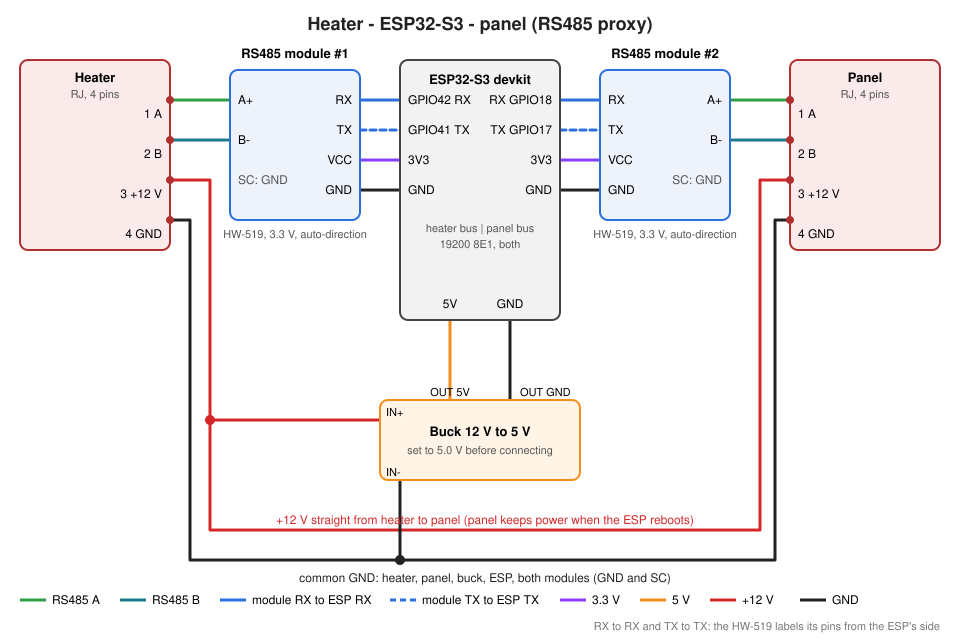

# Wiring

How the controller behaves is in [behaviour.md](behaviour.md).

The ESP32 sits **between** the heater and its control panel: the panel's
RS485 data lines go through the ESP, power goes straight from the heater to
the panel. Proven on Tylo Pure heaters with the basic panel, in Forward +
Control mode (panel through the ESP, web UI commands accepted by the heater).

## Parts

| Part | Notes |
|---|---|
| ESP32-S3 devkit (e.g. ESP32-S3-DevKitC-1 N16R8) | any ESP32-S3 with two free UARTs; other ESP32s work with other pins |
| 2x HW-519 TTL-to-RS485 module | **3.3 V**, auto-direction (no DE/RE pin to drive) |
| Buck converter 12 V to 5 V | e.g. LM2596 board, set to 5.0 V **before** connecting the ESP |
| RJ breakout or screw terminals | for the panel's A/B, so it can go back onto the heater by hand |

## Connection table

| From | To | Signal |
|---|---|---|
| Heater pin 1 | RS485 module #1 A+ | RS485 A, heater bus |
| Heater pin 2 | RS485 module #1 B- | RS485 B, heater bus |
| Module #1 pin marked **RX** | GPIO42 | heater bus to ESP receive |
| Module #1 pin marked **TX** | GPIO41 | ESP transmit to heater bus |
| Module #2 pin marked **RX** | GPIO18 | panel bus to ESP receive |
| Module #2 pin marked **TX** | GPIO17 | ESP transmit to panel bus |
| Module #2 A+ | Panel pin 1 | RS485 A, panel bus |
| Module #2 B- | Panel pin 2 | RS485 B, panel bus |
| Heater pin 3 (+12 V) | Buck IN+ **and** panel pin 3 | panel power stays direct |
| Heater pin 4 (GND) | Buck IN-, panel pin 4, both modules' SC, ESP GND | common ground |
| Buck OUT 5 V / GND | ESP 5V / GND | ESP power |
| ESP 3V3 / GND | Both modules' VCC / GND | **never 5 V** on the modules |

The GPIOs are the package defaults; change them with the `heater_tx_pin`,
`heater_rx_pin`, `panel_tx_pin` and `panel_rx_pin` substitutions. Both buses
run at 19200 baud, 8 data bits, even parity, 1 stop bit.

**Check the pinout of your own cables with a multimeter** before connecting:
pin 3 must be +12 V against pin 4, on the heater end and on the panel end.

## Things learned the hard way

- **RX to RX, TX to TX.** The HW-519 labels its RX/TX pins from the
  microcontroller's point of view, the opposite of what you might expect.
  Wired "crossed", the ESP receives nothing at all. Proven with a USB-TTL
  adapter: frames only arrived with the adapter's RX on the module's RX pin.
- **The heater accepts one panel only.** It searches (`98 7F 00 ..`) until a
  panel announces itself, assigns it address 0x40, and ignores any second
  announce. That is why the ESP sits *between* heater and panel instead of
  sharing the bus: a second talker can only collide with the panel. Details
  in [protocol.md](protocol.md).
- **Only the data lines go through the ESP.** +12 V and GND run straight
  from the heater, so the panel never loses power when the ESP reboots - it
  only loses the heater for a moment (it shows a connection error and
  re-registers within ~30 s of the ESP coming back).
- **Termination:** nothing extra was needed on the heater side. Add 120 ohm
  across module #2's A-B only if the panel bus shows garbled frames.

## Checking it from the web UI

Open the device's address (its DHCP address on your network, or
`http://192.168.4.1` after joining its own access point).

| Reading (Diagnostics) | Healthy |
|---|---|
| Heater Talking / Panel Responding | both on |
| Heater Frame Rate / Panel Frame Rate | about 30 frames/s each |
| Panel Reply Latency | about 8-15 ms |
| Panel Replies Missed / Late | flat after the first seconds |

The boot log prints the pin map (`Wiring: heater bus TX ... panel bus ...`),
so a unit can be checked against this page without opening it.

## Fallback without the ESP

Move the panel's A/B wires from module #2 back onto the heater's pins 1/2 (or
onto module #1's A+/B-, the same bus). The panel then talks to the heater
directly. With the ESP still on the heater bus, set **Bus Mode** to *Listen*
(Configuration): it then only reads and never transmits.
